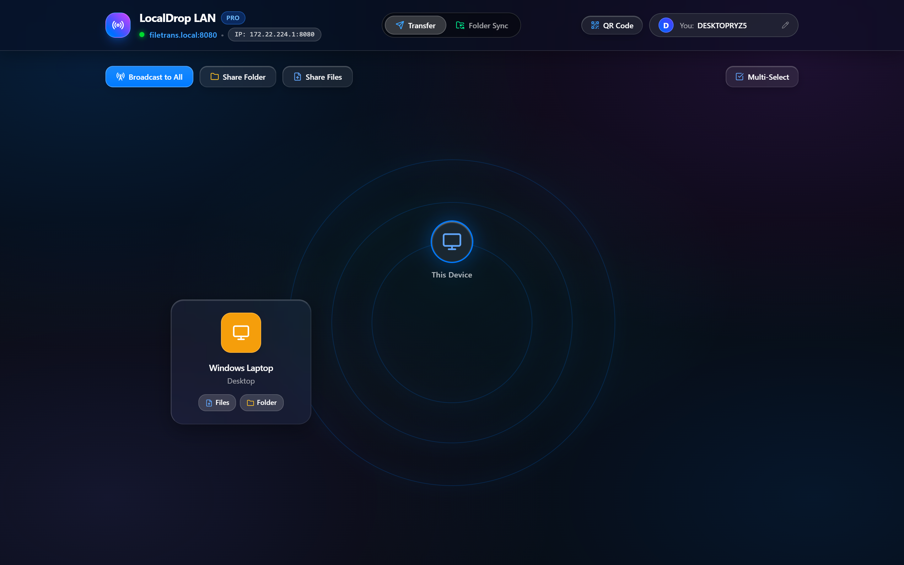
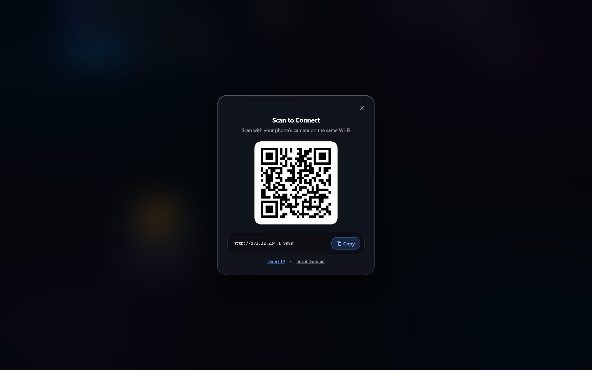
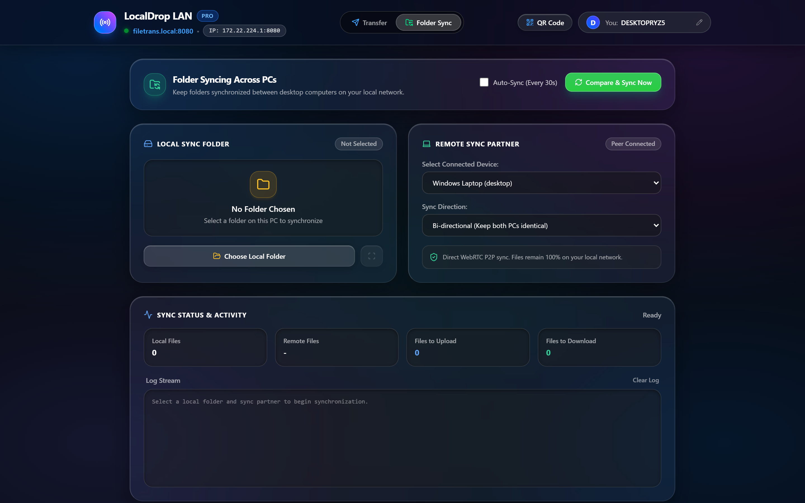
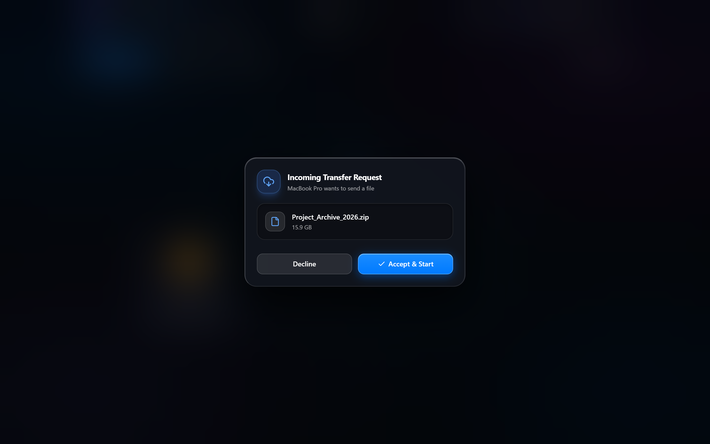

# LocalDrop LAN 🚀

Fast, secure, and private local file sharing and folder synchronization across your Wi-Fi and Ethernet. No cloud, no internet required, and no file size limits.

[](https://github.com/RahulRedkar/LocalDrop-LAN)
[](LICENSE)
[](./LocalDrop-LAN-Brochure.pdf)

---

## 📸 Screenshots

| Radar Discovery | Instant Mobile Connect |
|:---:|:---:|
|  |  |

| Folder Synchronization | Transfer Prompt |
|:---:|:---:|
|  |  |

---

## ✨ Features

- ⚡ **High-Speed Transfers:** Send files and folders directly across your local network at speeds up to 500 Mbps.
- 📦 **No File Size Limits:** Seamlessly transfer large files (15GB+) and entire folders directly to disk.
- 📡 **Zero-Config Discovery:** Automatically discovers nearby devices connected to the same Wi-Fi or LAN—no accounts or setup needed.
- 📱 **Mobile Friendly:** Scan the on-screen QR code with your phone or tablet camera to connect and transfer instantly.
- 🔄 **Folder Synchronization:** Sync and mirror entire folders between computers on your network with automated change detection.
- 🔒 **100% Private & Local:** All transfers stay completely within your local network. Your data never touches the cloud or external servers.
- 🌐 **Works Everywhere:** Compatible with Windows, Mac, Linux, iPhone, iPad, and Android through any modern web browser.

---

## 🚀 Getting Started

### Windows Installer (Easiest)
1. Download `LocalDrop-LAN-Setup.exe` from the [Releases](https://github.com/RahulRedkar/LocalDrop-LAN/releases) page.
2. Run the installer to install LocalDrop LAN on your PC.
3. Open **LocalDrop LAN** from your Start Menu or Desktop. Your browser will automatically open to `http://localhost:8080`.

### Running from Source
```bash
# Clone the repository
git clone https://github.com/RahulRedkar/LocalDrop-LAN.git
cd LocalDrop-LAN

# Install dependencies and start
npm install
npm start
```
Open `http://localhost:8080` in your web browser.

---

## 🔨 Building

- **Build Windows Executable:**
  ```bash
  npm run build:exe
  ```
- **Build Windows Installer:**
  Compile `installer.iss` with [Inno Setup](https://jrsoftware.org/isinfo.php).

---

## 👤 Created By
**Rahul Redkar** — Open Source Developer • Full Stack & Systems Engineering
- GitHub: [@RahulRedkar](https://github.com/RahulRedkar)

---

## 📜 License
This project is licensed under the [MIT License](LICENSE).
