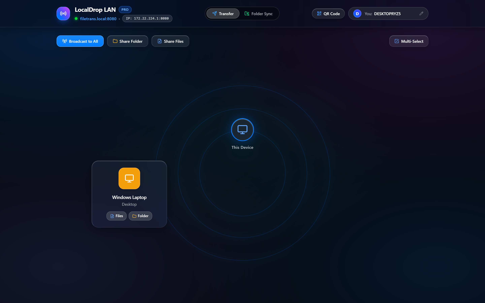
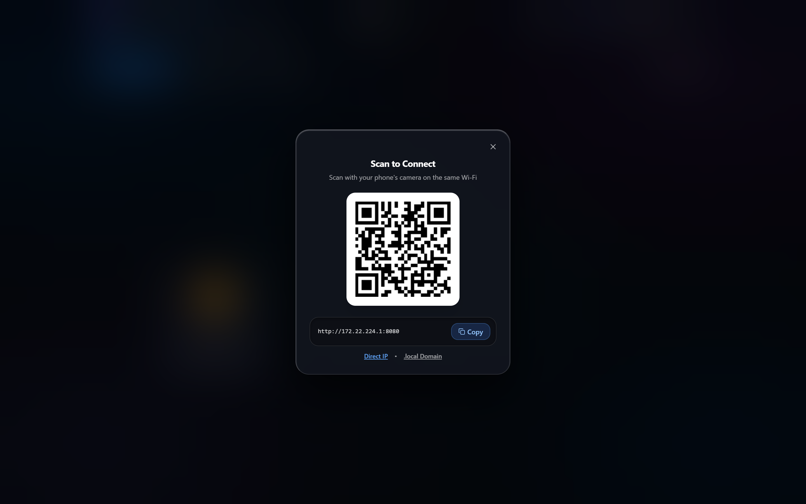
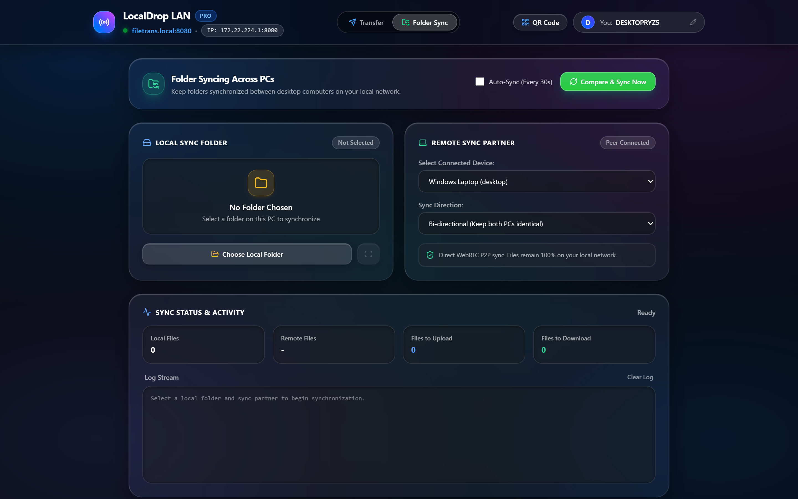
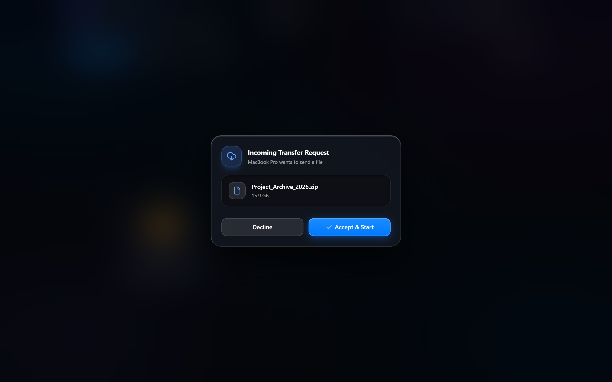

# LocalDrop LAN 🚀

Fast, secure, and private local file sharing and folder synchronization across your Wi-Fi and Ethernet. No cloud, no internet required, and no file size limits.

[](https://github.com/RahulRedkar/LocalDrop-LAN)
[](LICENSE)
[](./LocalDrop-LAN-Brochure.pdf)

---

## 📸 Screenshots

| Radar Discovery | Instant Mobile Connect |
|:---:|:---:|
|  |  |

| Folder Synchronization | Transfer Prompt |
|:---:|:---:|
|  |  |

---

## ✨ Features

- ⚡ **High-Speed Transfers:** Send files and folders directly across your local network at speeds up to 500 Mbps.
- 📦 **No File Size Limits:** Seamlessly transfer large files (15GB+) and entire folders directly to disk.
- 📡 **Zero-Config Discovery:** Automatically discovers nearby devices connected to the same Wi-Fi or LAN—no accounts or setup needed.
- 📱 **Mobile Friendly:** Scan the on-screen QR code with your phone or tablet camera to connect and transfer instantly.
- 🔄 **Folder Synchronization:** Sync and mirror entire folders between computers on your network with automated change detection.
- 🔒 **100% Private & Local:** All transfers stay completely within your local network. Your data never touches the cloud or external servers.
- 🌐 **Works Everywhere:** Compatible with Windows, Mac, Linux, iPhone, iPad, and Android through any modern web browser.
- 📶 **"No Wifi No Problem" Temporary Hotspot:** No Wi-Fi router nearby? Turn your laptop into an instant direct Wi-Fi hotspot with one click. Other devices join with a quick QR scan and transfer files at full hardware speed.
- 💬 **TalkBox LAN Messenger:** Instant local chatbox and photo drop between your laptops, phones, and tablets with broadcast and 1-on-1 private channels.
- 📦 **100% Offline Air-Gapped:** Zero external CDN dependencies. All styles, icons, and tools are bundled locally for complete functionality without internet access.

---

## 🚀 Getting Started

### Windows Installer (Easiest)
1. Download `LocalDrop-LAN-Setup.exe` from the [Releases](https://github.com/RahulRedkar/LocalDrop-LAN/releases) page.
2. Run the installer to install LocalDrop LAN on your PC.
3. Open **LocalDrop LAN** from your Start Menu or Desktop. Your browser will automatically open to `http://localhost:8080`.

### Running from Source
```bash
# Clone the repository
git clone https://github.com/RahulRedkar/LocalDrop-LAN.git
cd LocalDrop-LAN

# Install dependencies and start
npm install
npm start
```
Open `http://localhost:8080` in your web browser.

---

## 📖 How to Use LocalDrop LAN

### 1. Connect Devices to the Same Wi-Fi / LAN
Ensure all devices (PCs, laptops, smartphones, tablets) are connected to the same Wi-Fi router, mobile hotspot, or local switch.

### 2. Open LocalDrop on Your Devices
- **On your PC / Host:** Open LocalDrop from your desktop or browser (`http://localhost:8080`).
- **On Mobile (iPhone / Android) or Other Computers:**
  - Click the **QR Code** button in the top navigation bar.
  - Scan the QR code using your phone's default Camera app.
  - Or simply type `http://filetrans.local:8080` (or your PC's local IP address displayed on screen) into any mobile browser.

### 3. Send Files
1. Nearby devices appear automatically on the visual radar with their device names and operating systems.
2. Click or tap any peer card on the radar.
3. Select **"Send File(s)"** to choose single or multiple documents, photos, or videos.
4. The receiver will see an instant visual transfer prompt. Once accepted, the file streams directly at full hardware line speed.

### 4. Send Entire Folders (Zero-Zip Direct Placement)
1. In the top navigation bar, switch to the **"Folder Sync"** tab, or click a peer card and select **"Send Folder"**.
2. Select any directory from your computer.
3. LocalDrop recursively streams the directory tree directly to the destination without compressing or zipping first.

### 5. Keeping Up to Date
- Click the **"Update"** button in the header at any time to check for the latest releases.
- If a new version is available, a glowing badge appears in the header. You can download the latest clean ZIP installer bundle or sync the latest Web UI in-place with one click.

### 6. No Wi-Fi? No Problem! (Instant Hotspot Mode)
When you are on the go, outdoors, or in an environment without an active Wi-Fi router or switch:
1. LocalDrop automatically detects that you are offline and presents a top banner: *"No Wi-Fi Connection? No problem!"*.
2. Click **"Start Hotspot"** (or click the **"Hotspot"** button in the header).
3. LocalDrop initiates a temporary, secure Wi-Fi hotspot (`LocalDrop-Direct`).
4. Scan **QR Code 1** with your phone's camera to auto-join the Wi-Fi network.
5. Scan **QR Code 2** to instantly open the LocalDrop web interface and transfer files.
6. When done, click **"Stop Hotspot"** or simply close LocalDrop—the temporary hotspot tears down cleanly with zero residual changes.

### 7. TalkBox: Real-time LAN Chat & Image Drop
Switch to the **"TalkBox"** tab to chat and drop photos in real time:
- **General Room:** Broadcast messages, links, and code snippets to all connected devices on the LAN.
- **Direct 1-on-1:** Select any online device from the sidebar to start a private conversation.
- **Instant Images & Clipboard Paste:** Paste screenshots directly with `Ctrl+V`, drag-and-drop photos, or tap the image picker.
- **Lightbox Preview:** Click any image thumbnail to inspect full-screen or download with one click.

---

## 🔨 Building

- **Build Windows Executable:**
  ```bash
  npm run build:exe
  ```
- **Build Windows Installer:**
  Compile `installer.iss` with [Inno Setup](https://jrsoftware.org/isinfo.php).

---

## 👤 Created By
**Rahul Redkar** — Open Source Developer • Full Stack & Systems Engineering
- GitHub: [@RahulRedkar](https://github.com/RahulRedkar)

---

## 📜 License
This project is licensed under the [MIT License](LICENSE).
